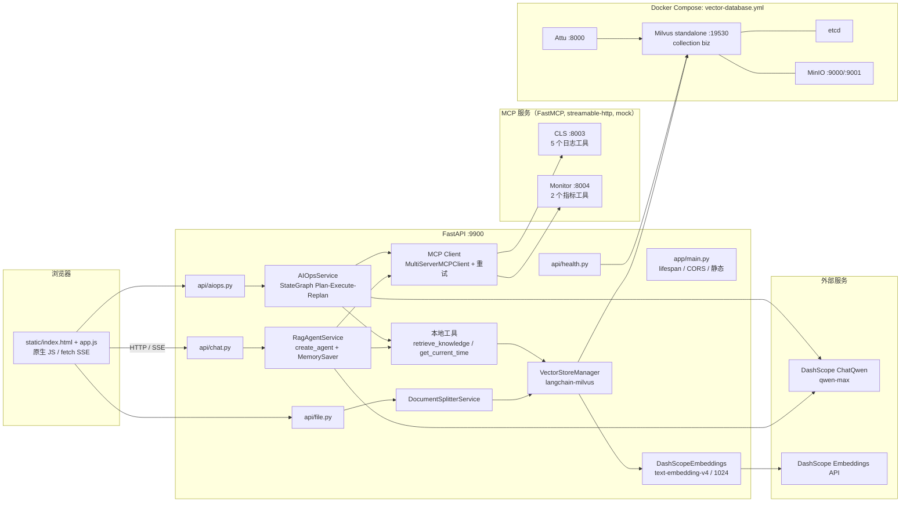

# OnCallAgent（SuperBizAgent）只读项目导览

> 分析方式：仅静态阅读源码、配置、脚本与锁文件；未安装依赖、未启动服务、未修改仓库。
> 所有结论均给出文件路径与行号；无法从代码确认的内容已明确标为“推测/待验证”。
> 敏感值未输出：`.env` 中的密钥只报告“是否占位”，`.claude/settings.local.json` 中的令牌已省略。

## 0. 结论速览

- 项目名：`SuperBizAgent`（UI 品牌“智能OnCall助手”），一个 FastAPI + LangChain/LangGraph 的 **RAG 问答 + AIOps 故障诊断** Web 应用。
- 两条主线：`/api/chat*` 走 RAG Agent；`/api/aiops` 走 Plan-Execute-Replan 图。
- 技术栈：FastAPI、LangChain 1.x、LangGraph、ChatQwen（DashScope/通义千问）、Milvus、MCP（FastMCP）、原生 JS 前端。
- **当前仓库无法直接启动**：`.env` 的 `DASHSCOPE_API_KEY` 等于代码里的占位符 `your-api-key-here`，`DashScopeEmbeddings` 在模块导入时即抛 `ValueError`（`app/services/vector_embedding_service.py:34-35,125-129`）。
- 运行时硬依赖：Milvus 必须在启动时可达（`app/main.py:29-32`）；首次聊天还要求两个 MCP 服务可达（`app/services/rag_agent_service.py:112-134`）。
- MCP 工具返回的全部是 **mock 数据**（`mcp_servers/README.md:134`；`cls_server.py`/`monitor_server.py` 内均为合成数据）。
- 仓库没有 `tests/`、CI、Dockerfile；`make test` 会因目录不存在而失败。
- 文档与代码存在多处漂移（健康检查路径、MCP 工具清单、Make 目标、`DASHSCOPE_API_BASE`、Python 版本）。

---

## 1. 项目基本信息

### 1.1 解决什么问题、主要场景

一句话：**面向 OnCall/运维场景的企业知识问答与自动故障诊断助手**。

- RAG 问答：把 `aiops-docs/*.md` 运维手册切分、向量化写入 Milvus；聊天时检索 Top-K 片段注入上下文（`app/services/rag_agent_service.py`、`app/tools/knowledge_tool.py`）。
- AIOps 诊断：给定固定诊断任务（“诊断当前系统是否存在告警……”），用 Planner → Executor → Replanner 图自动制定计划、调用日志/监控工具、生成 Markdown 诊断报告（`app/services/aiops_service.py:173-246`）。
- Web UI：`static/index.html` + `static/app.js`，支持快速/流式聊天、文件上传、AI Ops 按钮。

主要用户场景（由代码与文档推断）：值班人员询问运维知识、上传新手册、触发一次自动诊断。

### 1.2 技术栈清单（以及如何确认）

确认原则：以 `uv.lock` 的精确版本 + 代码中的实际 import/构造为准，不以 README 宣传为准。

| 层 | 技术 | 版本/配置 | 证据 |
|---|---|---|---|
| Web 框架 | FastAPI | 0.128.8 | `app/main.py:6,45-50`；`uv.lock:685-686` |
| ASGI | uvicorn | 0.40.0 | `app/main.py:84-93`；`uv.lock:3337-3338` |
| SSE | sse-starlette `EventSourceResponse` | 3.2.0 | `app/api/chat.py:8,169`；`app/api/aiops.py:7,153` |
| Agent 框架 | LangChain `create_agent` | 1.2.10 | `app/services/rag_agent_service.py:9,130-134`；`uv.lock:1271-1272` |
| 工作流 | LangGraph `StateGraph` / `MemorySaver` | 1.0.8 | `app/services/aiops_service.py:7-8,34-76`；`uv.lock:1414-1415` |
| LLM | ChatQwen（langchain-qwq） | 0.3.4；模型 `qwen-max` | `app/services/rag_agent_service.py:20,90-95`；`app/config.py:29,39`；`uv.lock:1386-1387` |
| LLM API | 阿里云 DashScope（OpenAI 兼容模式） | `https://dashscope.aliyuncs.com/compatible-mode/v1` | `app/services/vector_embedding_service.py:37-40`；`app/core/llm_factory.py:22` |
| Embedding | DashScope `text-embedding-v4`，1024 维 | 1024 | `app/config.py:30`；`app/services/vector_embedding_service.py:20-49,125-129` |
| 向量库 | Milvus standalone | 2.5.10；collection `biz` | `vector-database.yml:37-56`；`app/core/milvus_client.py:22-26` |
| 向量库配套 | etcd / MinIO / Attu | v3.5.18 / 2023-03-20 / v2.5 | `vector-database.yml:2-35,60-70` |
| Milvus 客户端 | pymilvus + langchain-milvus | 2.6.9 / 0.3.3 | `app/core/milvus_client.py:4-13`；`app/services/vector_store_manager.py:6,36-46`；`uv.lock` |
| MCP 服务端 | FastMCP `streamable-http` | 2.14.5 | `mcp_servers/cls_server.py:11,20,470`；`mcp_servers/monitor_server.py:18,27,435` |
| MCP 客户端 | langchain-mcp-adapters `MultiServerMCPClient` | 0.2.1 | `app/agent/mcp_client.py:8,161-183` |
| 配置 | pydantic-settings | 2.12.5 | `app/config.py:7,13-18,67` |
| 日志 | Loguru | 0.7.2+ | `app/utils/logger.py:11-46` |
| 前端 | 原生 JS + marked 11 + highlight.js 11 | 无构建系统 | `static/index.html:9-12,130`；`static/app.js:1-4` |
| 数据库 | 仅 Milvus；无 SQL/ORM | — | 全仓无 SQLAlchemy/ORM/迁移文件 |
| Python | `>=3.11,<3.14`；`.python-version` 3.13 | 3.13 | `pyproject.toml:7`；`.python-version` |

重要澄清：

- `dashscope` SDK 虽在依赖中（`pyproject.toml:17`），但代码 **没有 import**；聊天走 `langchain_qwq.ChatQwen`，embedding 走 OpenAI SDK。
- `httpx`/`aiohttp`/`aiofiles` 声明了但未见直接 import。
- `DASHSCOPE_API_BASE` 不在 `Settings` 字段中，`extra="ignore"` 会忽略它；全仓也没有 `load_dotenv`/`os.getenv`（已 grep 确认），所以 `.env` 里的该键**不会进入进程环境变量**。`ChatQwen` 自身会读取进程环境中的 `DASHSCOPE_API_BASE`（上游文档），但只有 shell 显式 export 才生效。embedding 的 base URL 是硬编码的（`app/services/vector_embedding_service.py:39`）。上游文档还指出 ChatQwen 未配置时默认走国际站（新加坡）endpoint；本仓库注释（`rag_agent_service.py:26-28`）与此一致。
- 版本号三处不一致：`pyproject.toml` 1.2.1、`app/__init__.py` 1.0.0、`app/config.py` 默认 1.0.0。

### 1.3 为什么不是猜测

- 依赖版本来自 `uv.lock`；实际使用来自源码 import/构造调用。
- Milvus 版本来自 `vector-database.yml` 镜像标签；collection 结构来自 `app/core/milvus_client.py` 的 `FieldSchema`。
- 端口来自 `mcp_servers/*.py` 的 `mcp.run(...)`、`vector-database.yml` 的 `ports`、`app/config.py` 默认值。
- 前端框架来自 `static/index.html` 的 script 标签与 `app.js` 的类写法。

---

## 2. 目录结构

### 2.1 根目录与一级目录职责

```
OnCallAgent/
├── app/                     # FastAPI 应用（约 3.3k 行）
│   ├── main.py              # 应用入口：lifespan、CORS、路由、静态文件
│   ├── config.py            # Pydantic Settings；.env → 全局 config
│   ├── api/                 # HTTP/SSE 路由层（chat/aiops/file/health）
│   ├── services/            # 业务层：RAG Agent、AIOps 图、向量流水线
│   ├── agent/               # MCP 客户端 + aiops 三节点（planner/executor/replanner）
│   ├── core/                # Milvus 管理器；LLMFactory（未使用）
│   ├── tools/               # 本地 LangChain 工具（知识检索、时间）
│   ├── models/              # Pydantic 请求/响应模型（部分未使用）
│   └── utils/               # Loguru 配置
├── mcp_servers/             # 两个 FastMCP 服务（日志/监控，均为 mock）
├── aiops-docs/              # 5 份中文运维 Runbook（RAG 语料）
├── static/                  # 原生 JS 前端（无构建）
├── Makefile                 # 一键 init/start/stop/upload/质量命令
├── start-windows.bat        # Windows 启动脚本
├── stop-windows.bat         # Windows 停止脚本
├── vector-database.yml      # Milvus + etcd + MinIO + Attu 的 Compose
├── pyproject.toml / uv.lock # 依赖与工具配置 / 锁定版本
├── .env                     # 本地配置（当前 API Key 为占位符）
├── .pre-commit-config.yaml  # 提交前格式化/检查
├── pyrightconfig.json       # Pyright 配置（3.10，与项目要求冲突）
├── .python-version          # 3.13
└── README.md                # 官方说明（存在漂移）
```

`app/` 内文件规模（行数）：`rag_agent_service.py` 403、`aiops_service.py` 341、`replanner.py` 307、`milvus_client.py` 285、`chat.py` 218、`mcp_client.py` 183、`vector_index_service.py` 175 等；总计约 3.3k 行 Python，整体体量小、可通读。

### 2.2 模块依赖关系

```
static/app.js ──HTTP/SSE──> app/main.py ──> app/api/*
                                          ├── chat.py ──> services/rag_agent_service.py
                                          │               ├── tools/* (retrieve_knowledge, get_current_time)
                                          │               ├── agent/mcp_client.py ──HTTP──> mcp_servers/*
                                          │               └── langchain create_agent + ChatQwen ──> DashScope
                                          ├── aiops.py ──> services/aiops_service.py
                                          │               └── agent/aiops/{planner,executor,replanner,state}
                                          │                   ├── tools/* + agent/mcp_client.py
                                          │                   └── ChatQwen ──> DashScope
                                          ├── file.py ───> services/vector_index_service.py
                                          │               ├── document_splitter_service.py
                                          │               └── vector_store_manager.py
                                          │                   ├── vector_embedding_service.py ──> DashScope
                                          │                   └── langchain_milvus.Milvus ──> Milvus
                                          └── health.py ─> core/milvus_client.py ──> Milvus
app/main.py ──> core/milvus_client.py (lifespan connect/close)
tools/knowledge_tool.py ──> services/vector_store_manager.py
```

关键点：

- `app/api` 只依赖 service；service 依赖工具/MCP/LLM；`core` 是最底层客户端。
- `app/agent/aiops` 由 `services/aiops_service` 组装成图；三节点本身不持有全局图。
- `mcp_servers` 不 import `app`，是独立进程，通过 HTTP 被调用。
- `vector_store_manager.delete_by_source` 在方法内部 import `milvus_manager`（`app/services/vector_store_manager.py:101`），用于避免循环依赖。
- 全项目使用模块级单例（`config`、`rag_agent_service`、`aiops_service`、`milvus_manager`、`vector_store_manager`、`vector_embedding_service`、`mcp_client`），没有依赖注入容器。

### 2.3 最值得优先阅读的 10 个文件

| # | 文件 | 理由 |
|---|---|---|
| 1 | `app/main.py` | 入口全貌：lifespan、路由前缀、静态挂载、CWD 假设 |
| 2 | `app/config.py` | 所有环境变量、默认值、MCP 端点；理解配置边界 |
| 3 | `app/services/rag_agent_service.py` | RAG Agent 的全部行为：create_agent、工具、MemorySaver、流式、会话 |
| 4 | `app/services/aiops_service.py` | AIOps 图怎么连、事件怎么变成 SSE、固定诊断任务 |
| 5 | `app/agent/aiops/planner.py` | 先检索经验文档再规划；Planner 的输入输出模型 |
| 6 | `app/agent/aiops/executor.py` | 单步执行与“只跑一轮工具”的关键约束 |
| 7 | `app/agent/aiops/replanner.py` | 继续/重规划/出报告的决策与 5/8 步硬限制 |
| 8 | `app/agent/mcp_client.py` | MCP 单例、重试拦截器、失败降级为 `isError` 结果 |
| 9 | `app/tools/knowledge_tool.py` + `app/services/vector_store_manager.py` | RAG 检索与 Milvus 字段映射的真实实现 |
| 10 | `mcp_servers/cls_server.py` + `mcp_servers/monitor_server.py` | 工具真实清单与 mock 数据形态；与 README 出入最大 |

推荐紧随其后：`app/api/chat.py`（SSE 协议）、`app/api/file.py`（上传/索引）、`app/core/milvus_client.py`（schema）、`static/app.js`（前端 SSE 解析）、`Makefile`（运行方式）。

---

## 3. 启动与运行

### 3.1 官方启动方式（README/Makefile）

Linux/macOS（README:34-58）：

```bash
pip install uv
uv venv
source .venv/bin/activate
uv pip install -e .
# 编辑 .env，填入真实 DASHSCOPE_API_KEY
make init     # Docker + start + wait + upload
make start    # 仅启动 MCP + FastAPI
```

Makefile 的实际动作：

- `make init` = `up` → `start` → `wait` → `upload`（`Makefile:96-125`）
- `make start` = `start-cls` → `start-monitor` → `start-api`（`Makefile:291-306`）
- `start-api`：`nohup .venv/bin/python -m uvicorn app.main:app --host 127.0.0.1 --port 9900 > server.log 2>&1 &`（`Makefile:309-321`）
- `start-cls` / `start-monitor`：`nohup .venv/bin/python mcp_servers/{cls,monitor}_server.py`（`Makefile:193-232`）
- `make dev`：`.venv/bin/python -m uvicorn app.main:app --reload --host 0.0.0.0 --port 9900`（`Makefile:423-425`）
- `make run`：同上，无 reload（`Makefile:428-430`）
- 注意：`make start-api` 绑定 `127.0.0.1`（`Makefile:315`），`make dev/run` 绑定 `0.0.0.0`（`Makefile:425,430`）；需要局域网访问时用后者。
- `make upload`：逐个 `curl -F "file=@..."` 到 `POST /api/upload`（`Makefile:437-473`）
- `make test`：`python3 -m pytest tests/ ...`（`Makefile:560-562`）——**tests/ 不存在，会失败**

Windows：`start-windows.bat` / `stop-windows.bat`（`start-windows.bat:1-174`）。注意该脚本会在检测到 `.python-version` 为 3.10 时**改写该文件**为 3.13（`start-windows.bat:29-35`）。

### 3.2 端口与服务

| 服务 | 地址/端口 | 证据 |
|---|---|---|
| FastAPI + Web UI | `http://localhost:9900` | `app/config.py:25`；`Makefile:7` |
| API 文档 | `http://localhost:9900/docs` | FastAPI 默认；`app/main.py:27` |
| 健康检查 | **`GET /health`**（不是 `/api/health`） | `app/main.py:62`；`app/api/health.py:13` |
| CLS MCP | `http://127.0.0.1:8003/mcp` | `mcp_servers/cls_server.py:470` |
| Monitor MCP | `http://127.0.0.1:8004/mcp` | `mcp_servers/monitor_server.py:435` |
| Milvus | `localhost:19530`（健康 9091） | `vector-database.yml:54-56` |
| MinIO | `9000`，控制台 `9001` | `vector-database.yml:25-27` |
| Attu | `http://localhost:8000` | `vector-database.yml:64-65` |

### 3.3 环境变量（只列键名与非敏感默认值）

| 键 | 必需性 | 默认值/说明 | 证据 |
|---|---|---|---|
| `APP_NAME` | 可选 | `SuperBizAgent` | `app/config.py:21` |
| `APP_VERSION` | 可选 | `1.0.0` | `app/config.py:22` |
| `DEBUG` | 可选 | 当前 `.env` 为 `True`；控制日志级别与 reload | `app/config.py:23`；`app/utils/logger.py:26`；`app/main.py:91` |
| `HOST` / `PORT` | 可选 | `0.0.0.0` / `9900`；仅 `python -m app.main` 使用 | `app/config.py:24-25`；`app/main.py:87-92` |
| `DASHSCOPE_API_KEY` | **实际必需** | 当前为占位符 `your-api-key-here` → 导入即抛错 | `app/services/vector_embedding_service.py:34-35` |
| `DASHSCOPE_MODEL` | 可选 | `qwen-max`（仅未被使用的 LLMFactory 读取） | `app/config.py:29`；`app/core/llm_factory.py:32` |
| `DASHSCOPE_EMBEDDING_MODEL` | 可选 | `text-embedding-v4` | `app/config.py:30` |
| `DASHSCOPE_API_BASE` | **仅 shell 环境生效** | `.env` 中有；`Settings` 无此字段，且无 `load_dotenv`，故 `.env` 值不会导出；ChatQwen 直接读进程环境 | `app/config.py:13-18`；全仓无 `load_dotenv`/`os.getenv`；上游 langchain-qwq 文档 |
| `MILVUS_HOST` / `MILVUS_PORT` / `MILVUS_TIMEOUT` | 可选 | `localhost` / `19530` / `10000ms` | `app/config.py:33-35` |
| `RAG_TOP_K` | 可选 | `3` | `app/config.py:38`；`knowledge_tool.py:31` |
| `RAG_MODEL` | 可选 | `qwen-max`（RAG 与三个 AIOps 节点都用它） | `app/config.py:39` |
| `CHUNK_MAX_SIZE` / `CHUNK_OVERLAP` | 可选 | `800` / `100`；二次切分实际用 `2×800=1600` | `app/config.py:42-43`；`document_splitter_service.py:32-37` |
| `MCP_CLS_TRANSPORT` / `MCP_CLS_URL` | 可选 | `streamable-http` / `http://localhost:8003/mcp` | `app/config.py:46-47` |
| `MCP_MONITOR_TRANSPORT` / `MCP_MONITOR_URL` | 可选 | `streamable-http` / `http://localhost:8004/mcp` | `app/config.py:48-49` |

补充：`.env` 文件由 `pydantic-settings` 从**当前工作目录**读取（`app/config.py:13-18`），所以必须在仓库根目录启动。未知键被 `extra="ignore"` 忽略。

### 3.4 外部依赖

- **Docker/Colima**：Milvus + etcd + MinIO + Attu（`vector-database.yml`）。`make up` 会在 Docker 不可用时尝试 `colima start`（`Makefile:134-137`）。
- **DashScope**：真实 API Key、网络可达、模型/配额可用。聊天 `qwen-max`，embedding `text-embedding-v4`。
- **两个本地 MCP 进程**：端口 8003/8004；无鉴权，仅绑定 127.0.0.1。
- **文件系统**：`static/`、`.env`、`logs/`、`uploads/`、`volumes/` 都是相对 CWD 的路径；`logs/`、`uploads/`、`volumes/` 当前不存在（运行时创建）。

### 3.5 已确认可用 vs 仍需验证

**仅凭代码可确认（静态确认）**：

- 依赖与版本、路由与前缀、端口、Milvus schema、上传/切分/embedding 调用链、MCP 工具清单与 mock 性质。
- `.env` Key 为占位符 → `DashScopeEmbeddings` 导入时报错（`vector_embedding_service.py:34-35`）。
- Milvus 连接失败会中止启动（`app/main.py:29-32` 无 try/except）。
- `make test` 因无 `tests/` 而失败（`pyproject.toml:121`；`Makefile:560-562`）。

**仍需实机验证（本次未运行）**：

- `uv sync` / `uv pip install -e .` 在 Python 3.13 下是否成功；`uv.lock` 是否完整。
- Docker/Colima 是否已安装、端口是否被占用。
- 真实 DashScope Key 是否有效、模型名/配额是否可用。
- ChatQwen 0.3.4 是否读取 shell 中的 `DASHSCOPE_API_BASE`；默认国际站/北京站点的实际行为。
- `langchain_milvus` 0.3.3 构造期连接的实机表现（上游源码/issue 指向“构造即连接”，但未在本仓库复现）。
- MCP 服务未启动时 `get_tools()` 的具体失败形态。
- `make init` 全流程是否一次通过。

### 3.6 常见启动障碍（按可能性排序）

1. **API Key 仍是占位符**：`your-api-key-here` 触发 `ValueError`，应用无法 import。必须先改 `.env`。
2. **Milvus 未启动**：`lifespan` 中 `milvus_manager.connect()` 抛错，uvicorn 启动失败。先 `docker compose -f vector-database.yml up -d`。
3. **没有 `.venv`**：Makefile 的所有启动目标硬编码 `.venv/bin/python`（`Makefile:199,220,315,425,430`）；当前目录没有 `.venv`（静态观察）。README 的 `uv venv` 会创建它。
4. **MCP 未启动**：首次 `/api/chat` 时 `_initialize_agent` 调 `get_tools()`，失败会导致整个聊天请求失败（`rag_agent_service.py:112-134,231-233`）。请先 `make start-cls`/`start-monitor`。
5. **文档未入库**：`uploads/`、`volumes/` 当前不存在，说明尚未初始化；未执行 `make upload` 前 RAG 检索为空。
6. **Python 版本冲突**：README 说 3.10+，`pyproject` 要求 3.11–3.13，pre-commit/pyright 配 3.10，`.python-version` 是 3.13。按 `pyproject` 为准。
7. **`make test` 失败**：没有 `tests/` 目录。
8. **`DASHSCOPE_API_BASE` 写在 `.env` 里无效**：应用没有 `load_dotenv`，`Settings` 也不声明该字段；需在启动前 `export DASHSCOPE_API_BASE=https://dashscope.aliyuncs.com/compatible-mode/v1`（或改代码显式传 `base_url`）。否则 ChatQwen 可能按上游默认走国际站，导致国内 Key 401（版本差异待实机确认）。
9. **前端 API 基址硬编码**：`static/app.js:4` 固定 `http://localhost:9900/api`；换域名/端口访问会跨域或指错。

---

## 4. 核心架构

### 4.1 程序入口与关键抽象

- 入口：`uvicorn app.main:app`（`app/main.py:84-93`）。
- 生命周期：启动连 Milvus，关闭断连（`app/main.py:19-41`）。
- 路由：`/health`、`/api/chat*`、`/api/upload`、`/api/index_directory`、`/api/aiops`（`app/main.py:62-65`）。
- 静态：`/static` 与 `/`（`app/main.py:67-81`）。
- 关键抽象：
  - `RagAgentService`：LangChain `create_agent` + `MemorySaver` + 本地/MCP 工具；`thread_id=session_id`。
  - `AIOpsService`：LangGraph `StateGraph`，三节点循环 + 条件边 + `MemorySaver`。
  - `MultiServerMCPClient`：把两个 MCP 服务的工具适配为 LangChain tools，带重试拦截器。
  - `Milvus`（langchain-milvus）+ `MilvusClientManager`（pymilvus）：两套访问路径，共享 collection `biz`。
  - `DashScopeEmbeddings`：LangChain `Embeddings` 实现，OpenAI SDK 调 DashScope。
  - `config`：全局 Pydantic Settings；`logger`：Loguru。

### 4.2 架构图



### 4.3 模块如何交互

1. 浏览器只与 FastAPI 通信；聊天/AIOps 用 POST + 手动解析 SSE（不是 `EventSource`，因为需要 POST）。
2. 路由层不做业务，只解析 Pydantic 模型并调用 service。
3. RAG service 首次请求时惰性初始化：拉取 MCP 工具 → `create_agent`。之后同一进程复用。
4. AIOps service 在构造时编译图；每次请求以 `thread_id=session_id` 流式执行。
5. 两个 Agent 都直接调用 DashScope；`retrieve_knowledge` 是唯一进入 Milvus 的工具路径。
6. 上传接口同步执行“存盘 → 删除旧分片 → 切分 → embedding → 写 Milvus”。
7. 健康检查只探 Milvus，不探 MCP/LLM。
8. MCP 服务独立进程，无鉴权，仅本机绑定。

### 4.4 典型请求链路（Web 后端 → 数据库）

**A. `POST /api/chat`（RAG，非流式）**

```
chat.py:17 chat(request)
  → rag_agent_service.query(question, session_id)          rag_agent_service.py:173
    → _initialize_agent()                                  :112
      → get_mcp_client_with_retry()                        agent/mcp_client.py:130
      → mcp_client.get_tools()                             :121
      → create_agent(model, tools, checkpointer)           :130-134
    → messages = [SystemMessage, HumanMessage]             :194-197
    → agent.ainvoke(..., thread_id=session_id)             :209-212
      → ChatQwen 决策 → 可能需要工具
      → retrieve_knowledge(query)                          tools/knowledge_tool.py:14
        → vector_store.as_retriever(k=RAG_TOP_K)           :29-34
        → DashScopeEmbeddings.embed_query                  vector_embedding_service.py:91
        → Milvus 相似度搜索（collection biz, L2）          core/milvus_client.py:116-175
        → format_docs(docs)                                knowledge_tool.py:51
      → ToolMessage 回填 → ChatQwen 生成最终 AIMessage
    → 取最后一条消息 content                              rag_agent_service.py:215-218
  → 包装 {code,message,data:{success,answer,errorMessage}}  api/chat.py:45-53
```

**B. `POST /api/aiops`（Plan-Execute-Replan，流式）**

```
aiops.py:16 → diagnose(session_id)                         aiops_service.py:159
  → 固定诊断任务 prompt                                     :173-246
  → execute(task, session_id)                              :81
    → graph.astream(initial_state, thread_id, updates)     :114-118
      → planner: retrieve_knowledge + 工具列表 + LLM(Plan)  planner.py:63-151
      → executor: bind_tools + ToolNode + LLM               executor.py:18-115
      → replanner: LLM(Act) 或 _generate_response(Response) replanner.py:111-294
      → 条件边: response→END / plan→executor                aiops_service.py:49-73
  → 每个节点输出格式化事件                                   :264-337
  → SSE yield plan/step_complete/status/report/complete     api/aiops.py:127-153
```

### 4.5 Agent Loop、模型调用、工具调用、状态、记忆、异常

**RAG Agent（`create_agent` 内部循环）**

- 模型：`ChatQwen(model=config.rag_model, temperature=0.7, streaming=True)`（`rag_agent_service.py:90-95`）。
- 循环由 LangChain 1.x `create_agent` 预置图负责：模型 → 工具 → 模型 … 直到无 tool calls。应用层没有 while 循环、没有 max_iterations、没有 token 上限（`rag_agent_service.py:130-134`）。
- 工具：本地 `retrieve_knowledge`、`get_current_time` + 动态 MCP 工具（`:97-98,118-128`）。
- 系统提示：每次请求作为 `SystemMessage` 追加（`:194-197,258-261`），不是在 `create_agent(system_prompt=...)` 中设置。
- 状态/记忆：`AgentState.messages` + `MemorySaver`，以 `thread_id=session_id` 保存；进程内、重启丢失；无 Redis/DB 后端（`:104,203-207`）。
- 历史修剪：`trim_messages_middleware` 已实现但**从未注册**（`:36-73`），因此历史会持续增长。
- 会话历史读取：`checkpointer.get(config)` → `channel_values["messages"]`（`:306-369`），且是同步调用放在 async 端点里。
- 初始化竞态：`_initialize_agent` 只用布尔标志、无锁（`:112-116`），两个并发的首次聊天可能各自创建一次 agent/工具列表。
- MCP 客户端没有关闭路径；`RagAgentService.cleanup` 只打日志且未注册到 lifespan（`:392-399`；`app/main.py:19-41`）。
- 异常：记录后 re-raise（`:231-233,298-304`）；API 层转成 500 响应体或 error SSE。

**AIOps Agent（显式图循环）**

- 模型：每次节点新建 `ChatQwen(temperature=0)`（`planner.py:125-129`、`executor.py:53-57`、`replanner.py:163-167`）。
- Planner：先 `retrieve_knowledge.ainvoke` 找经验文档（`planner.py:83`），再列工具、`with_structured_output(Plan)` 生成步骤（`:131-138`）。失败时返回 3 步兜底计划（`:153-162`）。
- Executor：每次只取 `plan[0]`；`bind_tools` + `ToolNode`；**只执行一轮工具**，第二轮工具调用不会执行（`executor.py:82-100`）。失败记为 `(task, "执行失败: ...")`（`:110-115`）。
- Replanner：`Act(action, new_steps)` 三选一；`past_steps >= 8` 强制出报告；`>= 5` 禁止 replan；`replan` 的新步骤数被截断到剩余步骤数（`replanner.py:129-138,205-233`）。最终用 `Response` 结构化输出（`:245-294`）。
- 状态：`PlanExecuteState{input, plan, past_steps(operator.add), response}`（`state.py:10-24`）。
- 记忆：`MemorySaver` + `thread_id=session_id`（`aiops_service.py:25,108-112`）。同一 session 重复诊断是否会累积 `past_steps` 需实测（推测可能，见第 9 节）。
- 异常：节点内兜底、服务层 error 事件（`aiops_service.py:151-157`）。

**MCP 工具调用**

- 客户端单例 + 重试拦截器：最多 3 次，指数退避 1s/2s；耗尽后返回 `CallToolResult(isError=True)` 而不是抛异常（`mcp_client.py:18-74`）。
- 工具清单是动态的：每次 `get_tools()`；AIOps 每个节点都会重新拉取一次（`planner.py:100-104`、`executor.py:45-50`、`replanner.py:149-153`）。
- 没有鉴权、没有超时配置（超时由 SDK 默认值决定，未在代码中设置）。

---

## 5. 核心业务流程

### 流程 1：RAG 流式聊天（最能代表项目）

1. 前端 `sendStreamMessage` 以 `POST /api/chat_stream` 发起请求，体为 `{Id, Question}`（`static/app.js:740-752`）。
2. `chat_stream` 创建 `EventSourceResponse`，把 service 的 chunk 映射为 SSE（`api/chat.py:68-169`）。
3. `RagAgentService.query_stream` 首次调用 `_initialize_agent`，之后 `agent.astream(stream_mode="messages")`（`rag_agent_service.py:235-277`）。
4. 只产出 `AIMessage/AIMessageChunk` 的 `content_blocks[type=text]`，以及最后的 `{"type":"complete"}`（`:281-296`）。
5. 若模型调用 `retrieve_knowledge`：工具同步执行，`DashScopeEmbeddings.embed_query` → Milvus `L2` 检索 Top-K=3 → `format_docs` 拼接 `【参考资料 i】`（`knowledge_tool.py:29-44,51-85`）。
6. 前端逐行解析 SSE，`content` 累积并实时渲染 Markdown；`done` 结束（`static/app.js:783-869`）。
7. 会话历史保存在 `MemorySaver` 与浏览器 `localStorage` 两处（后者上限 50 条，`app.js:316-323`）。

关键数据结构：`ChatRequest`（`models/request.py:9-22`）、`AgentState.messages`、`Document`（LangChain）、`ToolMessage`。

注意（均为静态确认）：
- `api/chat.py:101-128` 声明了 `tool_call/search_results/debug` 事件，但 `query_stream` 从不产出，属于**不可达分支**；`complete` 的 `data` 为 `None`（`:98,138-146`；`rag_agent_service.py:296`）。
- 流式失败会发两次 error：`query_stream` 先 yield error 再 re-raise（`rag_agent_service.py:298-304`），API 生成器捕获 re-raise 后再 yield 一次（`api/chat.py:159-167`）。
- `get_session_history` 把除 `HumanMessage` 外的所有消息（包括 `ToolMessage`）都标成 `assistant`（`rag_agent_service.py:342-346`），历史展示会混入工具结果。

### 流程 2：文档上传与 RAG 建库

1. `POST /api/upload` 接收 multipart；校验扩展名 `txt/md`、大小 10MB、文件名清洗（`api/file.py:14-18,32-66,131-162`）。
2. 文件写入 `./uploads/<safe_name>`；若同名先删除（`:52-66`）。
3. 调 `vector_index_service.index_single_file`（`:70-77`）；即使索引失败，接口仍返回成功，只记日志（`:75-77`）。
4. `index_single_file`：读 UTF-8 → `delete_by_source` 删除同源旧分片 → 切分 → `add_documents`（`vector_index_service.py:142-167`）。
5. 切分：Markdown 先按 `#/##` 标题切，再用 `RecursiveCharacterTextSplitter(chunk_size=1600, overlap=100)` 二次切，最后合并 <300 字符的小片（`document_splitter_service.py:22-37,61-76,134-172`）。元数据写入 `_source/_extension/_file_name` 与 `h1/h2`。
6. 入库：UUID 作为 `id`；LangChain `Milvus.add_documents` 自动调用 `embed_documents`（批量）→ DashScope 1024 维 → Milvus collection `biz`（`vector_store_manager.py:57-84`；`milvus_client.py:116-157`）。
7. 删除逻辑使用 JSON 路径表达式 `metadata["_source"] == "<path>"`，路径被直接拼进表达式（`vector_store_manager.py:104-108`）；当前输入来自服务端解析后的路径，风险有限，但属于字符串插值。
8. 也可 `POST /api/index_directory?directory_path=...` 批量索引目录（`api/file.py:100-128`）。

关键数据结构：`IndexingResult`（`vector_index_service.py:13-56`）、LangChain `Document`、Milvus schema（`id VARCHAR(100) PK, vector FLOAT_VECTOR(1024), content VARCHAR(8000), metadata JSON`）。

补充：运行时所有 LLM 都用 `config.rag_model`；`config.dashscope_model` 只被未使用的 `LLMFactory` 读取（`app/core/llm_factory.py:32`）。

**推测/注意**：
- 整条链路是同步调用（OpenAI SDK、pymilvus、langchain-milvus 都是同步），却在 async 路由中直接执行，会阻塞事件循环；大文件/慢 embedding 会拖慢其他请求。这是由代码结构推断的性能风险，未实测。
- `embed_documents` 把全部分片一次性传给 DashScope（`vector_embedding_service.py:75-80`），没有分批；超大文档可能触发服务端批量上限（需按 DashScope 文档验证）。
- 检索只有稠密向量 Top-K，没有 rerank、混合检索或分数阈值（全仓无 rerank 相关代码）；召回质量完全取决于 embedding 与切分。
- `aiops-docs` 手册里提到的工具名（`query_logs` 等）与实际 MCP 工具名（`search_log`、`query_cpu_metrics` 等）不一致，Planner 可能被文档误导（`aiops-docs/*.md` vs `mcp_servers/*.py`）。

### 流程 3：AIOps 自动诊断

1. 前端 `sendAIOpsRequest` → `POST /api/aiops {session_id}`（`app.js:1181-1195`）。
2. `diagnose` 使用固定中文任务，要求输出 Markdown 报告（`aiops_service.py:173-246`），然后 `execute`（`:248`）。
3. Planner：
   - 先检索知识库作为“经验文档”（`planner.py:77-90`）；
   - 拉取本地 + MCP 工具并格式化为文本（`:92-108`）；
   - `ChatQwen.with_structured_output(Plan)` 生成 4–6 步（提示词要求；实际步数由模型决定）（`:124-138`）。
4. Executor：执行 `plan[0]`，模型决定工具；`ToolNode` 执行；再让模型总结；返回 `plan[1:]` + `past_steps + [(task,result)]`（`executor.py:33-108`）。
5. Replanner：根据已执行步骤决定 `respond/continue/replan`；硬限制 8 步、≥5 步禁止 replan；`respond` 时用 `Response` 结构化输出生成报告（`replanner.py:111-294`）。
6. 条件边：有 `response` → END；否则若 `plan` 非空 → executor；计划空 → END（`aiops_service.py:49-73`）。
7. 事件：`plan`、`step_complete`、`status`、`report`、`complete`（`aiops_service.py:264-337`），由 API 转 SSE（`api/aiops.py:127-153`）。
8. 前端把 `plan/step_complete/status/report/complete` 拼接为可视化文本（`app.js:1224-1371`）。

**推测/风险**：
- `execute` 先发 `report`（含完整报告），随后发 `complete`（含 `response`）；`diagnose` 会把 `complete` 重写为 `diagnosis.report`（`aiops_service.py:250-260,310-337`）。前端只消费 `report`，不读取 `complete.diagnosis`，因此当前不会重复显示；但两个事件携带同一份内容，客户端若同时消费会重复（`app.js:1300-1325`）。
- 同一 `session_id` 复用 checkpoint 时，`past_steps` 使用 `operator.add`，可能跨次诊断累积，从而更早触发 5/8 步上限（LangGraph 语义推断，未实测）。
- Executor 只跑一轮工具，第二轮工具调用会被忽略（`executor.py:92-100`），复杂步骤可能信息不足。

---

## 6. 开发注意事项

### 6.1 代码规范

- 中文 docstring/注释/日志/提示词；标识符英文 snake_case；Google 风格 `Args/Returns/Raises`。
- 类型提示较全，使用 `str | None`、`TypedDict`、Pydantic v2；Python 3.11+ 语法。
- 行长 100；Ruff（E/W/F/I/C/B/UP，忽略 E501/B008/C901/W191）+ Black + isort（`pyproject.toml:60-109`）。
- 全局单例模式、模块级实例化；无 DI、无接口抽象。
- 提示词直接内嵌在 Python 中（`textwrap.dedent`），没有独立模板目录。

### 6.2 异常处理与日志

- 41 处 `except Exception`（`app/`），风格是“记录日志 + 返回兜底值/错误事件/重新抛出”。
- API 错误风格不统一：`/api/chat` 返回 HTTP 200 + `code:500` 响应体（`api/chat.py:55-65`）；`/api/chat/clear`、`/session` 抛 `HTTPException(500)`；流式接口发 error 事件。
- AIOps 节点有兜底：Planner 默认计划、Executor 失败步骤、Replanner 兜底报告。
- MCP 工具有重试与 `isError` 结果；LLM 调用没有重试。
- 日志：Loguru，控制台 + `logs/app_YYYY-MM-DD.log`，每日 0 点轮转、保留 7 天、zip 压缩、异步写入（`app/utils/logger.py:29-44`）。API Key 在日志中做掩码（`vector_embedding_service.py:51-56`）。

### 6.3 测试与配置管理

- **没有测试**：无 `tests/`、无 `conftest.py`、无 CI。`pytest` 配置齐全（`pyproject.toml:111-125`），`make test` 目前必失败。
- 配置：`.env` + Pydantic Settings；未知键忽略；无 schema 校验之外的启动校验（例如不知道 Key 是否真实有效）。
- 工具链缺口：Makefile 的 `security`（bandit）、`lint` 的 flake8 兜底、`watch`（pytest_watch）所依赖的包未出现在 `pyproject.toml` 的 dev extras 中；pre-commit 会自建环境，但本地 `python3 -m bandit` 可能找不到模块。
- 环境差异：README/pyproject/pyright/pre-commit/.python-version 对 Python 版本说法不一致；Windows 脚本会改写 `.python-version`。
- 版本管理：`uv.lock` 锁定依赖，但 Makefile 用 pip；README 同时给 uv 与 pip 两条路径。

### 6.4 复杂模块与隐含依赖

**复杂模块**：

- `rag_agent_service.py`：依赖 LangChain 1.x `create_agent` 的内部行为、流式 `content_blocks` 结构、`MemorySaver` 同步 API；升级依赖时最易坏。
- `replanner.py`：提示词与硬编码步数限制共同决定行为；改提示词前先理解 5/8 步约束。
- `static/app.js` 的 SSE 解析：手写行解析 + 正则匹配多 JSON，兼容分支很多，改动风险高。
- `vector_store_manager.py`：LangChain Milvus 的字段映射（`text_field/vector_field/metadata_field`）必须与 `milvus_client.py` 的 schema 完全一致，否则写入/检索失败。

**隐含依赖**：

- 必须在仓库根目录启动（`.env`、`static/`、`logs/`、`uploads/` 均为相对路径）。
- 导入 `app.services.vector_embedding_service` 即要求 Key 非占位；导入 `vector_store_manager` 即要求 Milvus 可达——`Milvus(...)` 在构造时连接（`app/services/vector_store_manager.py:36-46`；上游 langchain-milvus 的 `__init__` 会立即 `connections.connect`/`MilvusClient`，见参考链接）。因此 Milvus 未启动时，应用可能在 import 阶段而非 lifespan 阶段就失败。
- Milvus collection `biz` 维度固定 1024；维度不匹配会被**删除重建**，已有数据丢失（`milvus_client.py:78-88`）。
- 首次聊天要求两个 MCP 服务都可达；AIOps 的 Planner 对 MCP 失败有兜底，但 Executor 的步骤会失败。
- 单进程假设：`MemorySaver` 在进程内；多 worker 会导致会话分裂/丢失。

### 6.5 文档漂移与安全风险

**文档/代码漂移（已确认）**：

| 文档说法 | 实际 |
|---|---|
| `GET /api/health`（README:140） | `GET /health`（`main.py:62`） |
| README Python 3.10+ | `pyproject` 要求 3.11–3.13 |
| `DASHSCOPE_API_BASE` 可配置（README:245） | `Settings` 无此字段，embedding 硬编码 |
| `make mcp-start/stop/status`（mcp README:36-41） | 实际是 `start-cls/start-monitor/stop-*/status-mcp` |
| MCP 工具含 `search_service_logs`、`analyze_log_pattern` 等 | 实际只有 5 个 CLS 工具 + 2 个 Monitor 工具 |
| README 说自动获取告警（api/aiops.py 文档） | 实际使用固定诊断任务 |
| 前端 50MB 上限 | 后端 10MB 上限（`app.js:1119` vs `api/file.py:18`） |

**安全风险（静态发现）**：

- 所有 API 无鉴权；CORS `allow_origins=["*"]` + `allow_credentials=True`（`main.py:53-59`），浏览器规范下该组合本身是无效/危险的。
- `/api/index_directory` 接受任意目录路径并读取其中 `txt/md` 建库（`api/file.py:100-128`），可被用来读取/索引非预期目录。
- 前端用 `innerHTML` 渲染模型输出，未做 HTML 清洗（`app.js:72-73,917-918` 等），存在 XSS 风险（推测）。
- `.gitignore` 未忽略 `.env`（只忽略 `.env.local`，`.gitignore:46`），也未忽略 `.claude/`；`.claude/settings.local.json` 内含明文 `ANTHROPIC_AUTH_TOKEN`（本次未输出）。当前目录不是 git 仓库，但一旦初始化并提交会泄露。
- MinIO 使用默认账号 `minioadmin`（`vector-database.yml:23-24`）；仅适合本地开发。
- MCP 服务无鉴权，仅绑定 127.0.0.1，尚可接受。

### 6.6 适合新开发者上手的任务

1. **修文档漂移**：健康检查路径、MCP 目标名、工具清单、Python 版本、`DASHSCOPE_API_BASE` 说明。风险低、收益高。
2. **补齐 `.env.example`**：列出键名与占位值，移除真实 Key；同时把 `.env`、`.claude/` 加入 `.gitignore`。
3. **建立 `tests/` 最小骨架**：`/health`、上传校验（扩展名/大小）、`DocumentSplitterService` 分片、`format_docs`。让 `make test` 可运行。
4. **把 `trim_messages_middleware` 正确接入 `create_agent`**（LangChain 1.x 的 `middleware=`），并补测试；解决历史无限增长。
5. **补 MCP 不可用时的优雅降级**：首次聊天 `get_tools()` 失败时不阻塞，只禁用 MCP 工具；健康检查加入 MCP/LLM 探活。
6. **清理死代码**：`LLMFactory`、`VectorSearchService`、未使用的 Pydantic 模型、`api/chat.py` 中不可达 SSE 分支。
7. **给上传/索引加异步执行**（`run_in_threadpool` 或任务队列），避免阻塞事件循环。
8. **统一 AIOps 完成事件**：当前 `report` 与 `complete.diagnosis.report` 携带同一份内容，客户端消费约定不清晰；建议只保留一种，或在前端明确忽略 `complete.diagnosis`。

---

## 7. 最终输出：结构化项目导览

### 7.1 一句话项目介绍

> SuperBizAgent（智能OnCall助手）是一个基于 FastAPI + LangChain/LangGraph + DashScope Qwen + Milvus 的运维助手：一边用 RAG 回答运维知识，一边用 Plan-Execute-Replan 编排 MCP 日志/监控工具自动生成故障诊断报告。

### 7.2 技术栈清单（速查）

- Web：FastAPI、uvicorn、sse-starlette
- Agent：LangChain 1.2.10（`create_agent`）、LangGraph 1.0.8（`StateGraph`/`MemorySaver`）、langchain-qwq 0.3.4（`ChatQwen`）
- LLM：DashScope `qwen-max`
- Embedding：DashScope `text-embedding-v4`（1024 维，OpenAI SDK）
- 向量库：Milvus 2.5.10 + etcd + MinIO + Attu（Docker Compose）
- 工具协议：MCP / FastMCP 2.14.5（streamable-http）+ langchain-mcp-adapters 0.2.1
- 配置/日志：pydantic-settings、Loguru
- 前端：原生 JS + marked + highlight.js
- 无 SQL/ORM；无消息队列；无缓存中间件

### 7.3 目录结构图（速查）

```
app/{main.py, config.py, api/, services/, agent/{mcp_client.py, aiops/}, core/, tools/, models/, utils/}
mcp_servers/{cls_server.py, monitor_server.py}   # 8003 / 8004，mock 数据
aiops-docs/*.md                                   # 5 份 Runbook
static/{index.html, app.js, styles.css}           # 无构建前端
vector-database.yml                               # Milvus 栈
Makefile / start-windows.bat / stop-windows.bat   # 运行脚本
pyproject.toml / uv.lock / .env / README.md
```

### 7.4 架构图

见 4.2 的 Mermaid 图。核心分层：**浏览器 → FastAPI 路由 → Service（RAG/AIOps）→ LangChain/LangGraph → 工具（本地 + MCP）→ Milvus/DashScope**。

### 7.5 核心调用链（速查）

- 聊天：`POST /api/chat[_stream]` → `RagAgentService.query[_stream]` → `create_agent.ainvoke/astream` → `ChatQwen` → `retrieve_knowledge` → `Milvus` → 最终 `AIMessage` → SSE/JSON。
- 建库：`POST /api/upload` → `VectorIndexService.index_single_file` → `DocumentSplitterService` → `DashScopeEmbeddings` → `Milvus(biz)`。
- 诊断：`POST /api/aiops` → `AIOpsService.diagnose` → `planner → executor → replanner` 循环 → `report/complete` SSE。

### 7.6 关键文件阅读清单（10 个）

1. `app/main.py`
2. `app/config.py`
3. `app/services/rag_agent_service.py`
4. `app/services/aiops_service.py`
5. `app/agent/aiops/planner.py`
6. `app/agent/aiops/executor.py`
7. `app/agent/aiops/replanner.py`
8. `app/agent/mcp_client.py`
9. `app/tools/knowledge_tool.py` + `app/services/vector_store_manager.py`
10. `mcp_servers/cls_server.py` + `mcp_servers/monitor_server.py`

### 7.7 本地启动步骤（推荐顺序）

```bash
# 0. 前提：Python 3.11–3.13、Docker（或 Colima）、真实 DashScope Key
cd /Users/smithdong/Desktop/OnCallAgent/OnCallAgent

# 1. 安装
pip install uv
uv venv
source .venv/bin/activate
uv pip install -e .

# 2. 配置：把 .env 的 DASHSCOPE_API_KEY 换成真实 Key（当前是占位符）
#    其余键保持默认即可

# 3. 启动 Milvus 栈
docker compose -f vector-database.yml up -d
# 等待 5–10 秒；确认 milvus-standalone 健康

# 4. 启动 MCP 服务（两个终端，或 make start-cls / start-monitor）
python mcp_servers/cls_server.py      # :8003
python mcp_servers/monitor_server.py  # :8004

# 5. 启动 API
python -m uvicorn app.main:app --host 0.0.0.0 --port 9900
# 或 make dev

# 6. 校验
curl http://localhost:9900/health
# 打开 http://localhost:9900 与 http://localhost:9900/docs

# 7. 建库（首次必须）
make upload
# 或 curl -X POST http://localhost:9900/api/upload -F "file=@aiops-docs/cpu_high_usage.md"

# 8. 试用
# 聊天：POST /api/chat {"Id":"s1","Question":"CPU 使用率过高怎么排查？"}
# 诊断：POST /api/aiops {"session_id":"s1"}
```

一键方式：改好 Key 后 `make init`（= 启动 Docker + 全部服务 + 等待 + 上传文档）。

### 7.8 术语表

| 术语 | 含义 |
|---|---|
| OnCall | 值班/随叫随到的运维响应 |
| AIOps | 用 AI 做告警分析、根因定位、运维建议 |
| RAG | 检索增强生成：先查知识库再让 LLM 回答 |
| MCP | Model Context Protocol，模型调用外部工具的协议 |
| FastMCP | Python 的 MCP 服务端框架 |
| streamable-http | MCP 的 HTTP 传输方式（本项目使用） |
| LangGraph | LangChain 的图式 Agent 编排框架 |
| StateGraph | LangGraph 的状态图；节点读写共享状态 |
| Checkpointer / MemorySaver | 图状态检查点；本项目为进程内内存实现 |
| thread_id | LangGraph 会话标识；本项目等于 `session_id` |
| Plan-Execute-Replan | 先规划、再执行、再根据结果重规划/出报告的模式 |
| Planner / Executor / Replanner | 上述模式的三个节点 |
| Structured Output | 用 Pydantic 模型约束 LLM 输出结构 |
| Tool Calling | LLM 返回工具名+参数，由框架执行 |
| ToolNode | LangGraph 预置节点，自动执行工具调用 |
| Embedding | 文本向量化；本项目 1024 维 |
| Chunk | 文档切片；Markdown 按标题 + 递归字符切分 |
| Milvus collection | Milvus 中的表；本项目为 `biz` |
| IVF_FLAT / L2 | 向量索引类型 / 欧氏距离度量 |
| Attu | Milvus 的 Web 管理界面 |
| SSE | Server-Sent Events，服务端单向流式推送 |
| DashScope | 阿里云百炼模型服务 |
| Qwen | 通义千问模型系列 |
| Runbook | 运维处置手册；本项目 `aiops-docs/*.md` |

### 7.9 尚未确认的问题

1. **未实机运行**：本次未安装依赖、未启动 Docker/服务，所有运行时行为均为静态推断。
2. `ChatQwen` 0.3.4 在未显式 `base_url` 时的确切默认 endpoint（上游文档称默认国际站，但未针对 0.3.4 源码逐行核实）；以及 `DASHSCOPE_API_BASE` 在 shell 中 export 后是否被 0.3.4 读取。
3. `langchain_milvus` 0.3.3 的构造期连接行为已由上游 issue/源码线索支持（构造即连接），但未在本仓库实机复现。
4. MCP 服务未启动时 `MultiServerMCPClient.get_tools()` 是抛异常还是返回空列表；首次聊天是否必然 500。
5. 同一 `session_id` 重复调用 `/api/aiops` 时，`MemorySaver` + `operator.add` 是否会让 `past_steps` 跨请求累积（推测会）。
6. `create_agent` 在 LangGraph 1.0.8 下的默认递归/迭代上限（常见为 25，但未在锁定源码中核实）。
7. `MemorySaver.get()` 的同步用法与 `delete_thread()` 在 langgraph 1.0.8 中是否与代码假设一致。
8. `uv.lock` 在 Python 3.13 下是否可直接 `uv sync`（未验证）。
9. 真实模型/工具延迟、token 消耗、DashScope 配额。
10. 文档是否曾被索引（`uploads/`、`volumes/` 均不存在）。
11. 生产部署形态（单进程？反向代理？鉴权？）没有任何配置或文档。
12. `dashscope` SDK 依赖为何保留但未使用；是否为历史遗留。

### 7.10 按优先级排序的学习路线

**P0（半天）— 建立运行地图**

1. `README.md` + `Makefile`（`init/start/stop/upload/dev`）
2. `app/main.py`（入口、路由、lifespan）
3. `app/config.py` + `.env`（所有配置项）
4. `vector-database.yml`（Milvus 栈与端口）

目标：能画出进程/端口拓扑；知道为什么当前起不来（占位 Key、Milvus/MCP/.venv）。

**P1（1 天）— 吃透 RAG 聊天**

1. `app/api/chat.py`
2. `app/services/rag_agent_service.py`
3. `app/tools/knowledge_tool.py` + `app/services/vector_store_manager.py`
4. `app/services/vector_embedding_service.py`
5. `app/core/milvus_client.py`

目标：能解释一次聊天从 HTTP 到 Milvus 再回到 SSE 的每一步；知道 `MemorySaver` 与历史增长问题。

**P2（半天）— 吃透建库链路**

1. `app/api/file.py`
2. `app/services/vector_index_service.py`
3. `app/services/document_splitter_service.py`
4. `app/core/milvus_client.py` 的 schema/index
5. `aiops-docs/*.md`

目标：能新增一份 Runbook 并验证检索命中；理解 chunk 大小与 1024 维约束。

**P3（半天）— MCP 工具面**

1. `app/agent/mcp_client.py`
2. `mcp_servers/cls_server.py`
3. `mcp_servers/monitor_server.py`
4. `app/config.py` 的 MCP 配置

目标：能直接调用 MCP 工具、看懂工具返回结构、知道哪些是 mock。

**P4（1 天）— AIOps 主流程**

1. `app/services/aiops_service.py`
2. `app/agent/aiops/state.py`
3. `app/agent/aiops/planner.py`
4. `app/agent/aiops/executor.py`
5. `app/agent/aiops/replanner.py`
6. `app/api/aiops.py`

目标：能解释一张诊断图如何循环、5/8 步限制从哪来、报告如何生成与推送。

**P5（半天）— 前端与质量**

1. `static/app.js`（SSE 解析、localStorage、上传）
2. `pyproject.toml` + `.pre-commit-config.yaml`
3. 死代码/文档漂移/安全风险清单（第 6 节）

目标：能改前端事件处理；能跑通 lint/format；能挑一个 6.6 的任务开工。

**建议的第一个动手实验**：填入真实 Key → 启动 Milvus + MCP + API → `make upload` → 问“CPU 使用率过高怎么排查？” → 触发一次 `/api/aiops` → 对照日志（`logs/app_*.log`、`mcp_cls.log`、`mcp_monitor.log`）观察 planner/executor/replanner 事件。

---

## 8. 确认后的建议下一步

分析阶段未修改任何仓库文件；本导览是随后新增的唯一文档。建议按以下顺序之一推进：

1. **先跑通**：准备真实 `DASHSCOPE_API_KEY`（并在 shell export 正确的 `DASHSCOPE_API_BASE`）→ 创建 `.venv` 安装依赖 → 启动 Milvus/MCP/API → `make upload` → 冒烟测试 `/health`、`/api/chat`、`/api/aiops`。
2. **先补测试**：创建 `tests/` 最小骨架（health、上传校验、切分器、format_docs），让 `make test` 可运行。
3. **先治理风险**：`.env`/`.claude/` 加入 `.gitignore`、移除明文令牌、为管理类接口加鉴权、修复文档漂移。
4. **先深入业务**：按 7.10 的 P1–P4 路线做 RAG 或 AIOps 的代码走读与改造。

在未得到明确指示前，不进行任何写操作或服务启动。
